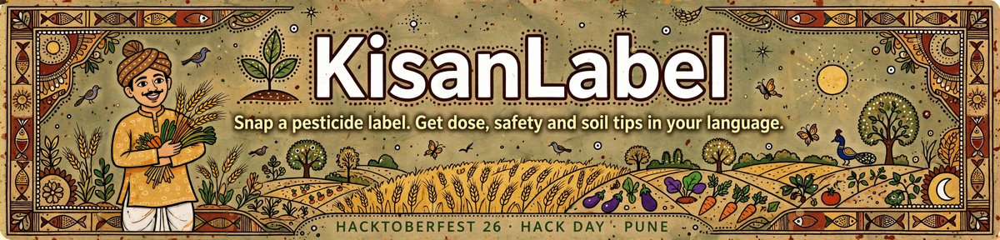
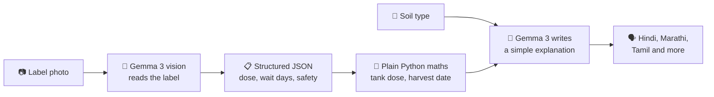

<p align="center">
  
</p>

<p align="center">
  
  
  
  
  
  
</p>

Pesticide labels are dense and often in English or mixed languages😵‍💫. Wrong use causes illness🤒,
crop damage‼️ and wasted money. KisanLabel lets a farmer **take a photo of the label** and get:

- the **right dose for their own tank** (e.g. 16 L knapsack sprayer)
- the **waiting period** and the **earliest safe harvest date📅🟢**
- **safety steps and first aid⛑️**, explained in **their own language**
- **⚠️cautions for their soil type** (sandy, red, black cotton, alluvial, laterite, clay)
- a **Find a product** tab that suggests products for a crop + pest from a verified list☑️

## How it works🛠️

<p align="center">
  <b>Problem Statement #5: Pesticide Label Reader for Indian Farmers</b><br>
  Built by <b>Team Spooky Wookys</b> at Hacktoberfest 26 Hack Day (NST.ADYPU · NSTSDC, Pune)
</p>

---

## 😟 The problem
>>>>>>> 

Pesticide labels are **dense, tiny, and often in English or mixed languages**.
Small and low-literacy farmers guess the dose, skip the waiting period, or skip the safety steps.
The result: **illness, crop damage and wasted money**.

## 💡 Our solution

A farmer **takes a photo of the label**. KisanLabel replies with what matters, in their own language:

| | What they get |
|---|---|
| 🧪 | **Exact dose for their own tank** (e.g. 16 L knapsack sprayer), with the working shown |
| 📅 | **Waiting period** and the **earliest safe harvest date** |
| ☠️ | **Toxicity colour** explained (red / yellow / blue / green) |
| 🦺 | **Safety steps and first aid** in simple words |
| 🌱 | **Soil-specific cautions** (sandy, red, black cotton, alluvial, laterite, clay) |
| 🔎 | **Find a product** tab: suggestions for a crop + pest, only from a verified list |
| 🗣️ | **9 languages**: English, Hindi, Marathi, Gujarati, Tamil, Telugu, Kannada, Bengali, Punjabi |

## ⚙️ How it works



1. **Read** (`kisanlabel/extract.py`): Gemma 3 looks at the photo and returns JSON. Anything it can't read becomes `null` and is listed as unreadable. It is told never to guess.
2. **Calculate** (`kisanlabel/dose.py`): tank dose, acres covered and harvest date are computed in plain Python, with the working shown so anyone can check it.
3. **Add soil context** (`kisanlabel/soil.py`): cautions for the farmer's soil and the kind of product.
4. **Explain** (`kisanlabel/explain.py`): Gemma 3 turns the checked facts into short, simple text in the chosen language. It may only use those facts.

> [!IMPORTANT]
> **The AI never does the arithmetic.** A wrong number on a pesticide can hurt someone, so the model only *reads* and *explains*. Doses and dates come from tested Python code.

## Soil and product recommendations💭 (how it's kept safe)

Which pesticide to use depends mainly on the **crop and pest/disease🦠**, not on soil. Soil changes
how a chemical behaves (washes into groundwater, sticks, lasts) and how a soil-applied product
should be dosed. So:

- `kisanlabel/soil.py` gives **soil-specific cautions⚠️** (e.g. leaching on sandy soil, cracks in black cotton soil).
- `kisanlabel/recommend.py` suggests products **only from `data/registered_products.csv`**, a list the
  team fills from CIB&RC and agriculture-university sources✅. The AI never invents a product.
- The app always tells users to confirm with the agriculture officer👮 / KVK and read the printed label.

## Backend API (FastAPI)⚙️

> [!NOTE]
> **Soil does not pick the pesticide.** The right product depends mainly on the **crop and the pest or disease**. Soil changes how a chemical behaves (washes away, sticks, lasts), so we use it for cautions. Product suggestions come **only** from `data/registered_products.csv`, which is filled from trusted sources. The AI never invents a product name.

## 🚀 Quick start

```bash
git clone https://github.com/PrinceVerma44/Pesticide-Label-Reader-for-Indian-Farmers-Spooky_Wookys.git
cd Pesticide-Label-Reader-for-Indian-Farmers-Spooky_Wookys

python3 -m venv .venv
source .venv/bin/activate          # Windows: .venv\Scripts\activate
pip install -r requirements.txt
>>>>>>> main

cp .env.example .env               # Windows: copy .env.example .env
# open .env and paste your free GEMMA_API_KEY from Google AI Studio

streamlit run app.py               # web app at http://localhost:8501
```

<details>
<summary><b>🔌 Run the backend API too</b> (click to open)</summary>

```bash
uvicorn backend.main:app --reload --port 8000
```

Open **http://localhost:8000/docs** for interactive API docs.

| Method | Path | What it does | Calls Gemma? |
|---|---|---|---|
| GET | `/health` | Is the server up | no |
| GET | `/api/meta` | Languages, soil types, default tank size | no |
| POST | `/api/label/read` | Label photo → structured JSON | yes |
| POST | `/api/analyze` | JSON → tank dose, harvest date, soil cautions | no |
| POST | `/api/explain` | Same input + `language` → simple explanation | yes |
| GET | `/api/products?crop=&pest=&soil=` | Verified products + soil cautions | no |
| POST | `/api/products/explain` | Explain product suggestions in a language | yes |

```bash
curl -F "image=@samples/label.jpg" http://localhost:8000/api/label/read
```

Built in: image type and 8 MB limits, per-IP rate limit on Gemma endpoints, clean error messages, CORS via `CORS_ORIGINS`, and the API key stays on the server.

## Run it🚀

</details>

<details>
<summary><b>🧪 Run the tests</b></summary>


```bash
pytest
```

## Models, tools and licenses📦

The tests use fake model replies, so they need no API key or internet.


</details>

## 🗂️ Project structure

```text
.
├── app.py                  # Streamlit web app
├── backend/                # FastAPI REST API
│   ├── main.py             #   endpoints
│   ├── service.py          #   logic behind the endpoints (no web framework)
│   └── ratelimit.py        #   per-IP rate limit
├── kisanlabel/             # Core logic
│   ├── extract.py          #   Gemma 3 reads the label photo
│   ├── dose.py             #   tank dose, acres, harvest date
│   ├── soil.py             #   soil-aware cautions
│   ├── recommend.py        #   verified product finder
│   ├── explain.py          #   local-language explanations
│   ├── toxicity.py         #   red / yellow / blue / green colour code
│   └── ...
├── data/                   # registered_products.csv (verified list)
├── tests/                  # unit and API tests
├── samples/                # real label photos for testing
└── docs/                   # banner and extra notes
```

## 🧰 Models, tools and licenses

| What | Used for | License |
|---|---|---|
| **Gemma 3** (`gemma-3-4b-it`, optional `gemma-3-27b-it`) | Reads label photos, writes explanations | See the Gemma 3 model card |
| Streamlit | Web UI | Apache-2.0 |
| FastAPI | Backend API | MIT |
| google-genai (Python SDK) | Calls Gemma models | Apache-2.0 |
| python-dotenv | Loads `.env` | BSD-3-Clause |
| pytest | Tests | MIT |
| CIB&RC and agriculture-university data (we add) | Verified product list | Check each source's terms |
| **This project** | | MIT (see `LICENSE`) |

## AI tools used while building⛏️

**AI tools used while building:** parts of the scaffold were drafted with an AI assistant (Claude). The team reviewed the code and can explain every module.


## ⚠️ Safety and limits

## Limits and safety⚪️

> [!WARNING]
> KisanLabel is a **helper, not a replacement for the printed label** or an agriculture officer.
> If unsure, call the **Kisan Call Centre: 1800-180-1551** or visit your local Krishi Vigyan Kendra.
 

- 📸 Photo quality matters. Glare, folds and tiny print reduce accuracy, and the app flags unreadable fields.
- 🎯 Doses depend on crop and pest, so the farmer must pick the right row from the label.
- 🌐 Translations are model-generated and should be checked by native speakers before real rollout.

## Ideas for next steps🌀

- Offline / on-device Gemma for villages with poor internet
- Voice input and read-aloud output
- Warn when two products are mixed that should not be
- Test set of real Indian labels with accuracte numbers
- 

## 🗺️ Roadmap

- [x] Label photo → structured data (Gemma 3 vision)
- [x] Tank dose, acres per tank, safe harvest date
- [x] Soil-aware cautions
- [x] Explanations in 9 languages
- [x] REST API with rate limiting
- [ ] Fill the verified product list from CIB&RC and agriculture-university sources
- [ ] Native-speaker review of the translations
- [ ] Accuracy test on real Indian labels, with results published here
- [ ] Voice input and read-aloud for low-literacy users
- [ ] Offline mode with an on-device Gemma model

## 🤝 Team

**Team Spooky Wookys**, Hacktoberfest 26 Hack Day, Pune.

## 📄 License

MIT. See [`LICENSE`](LICENSE).
 
